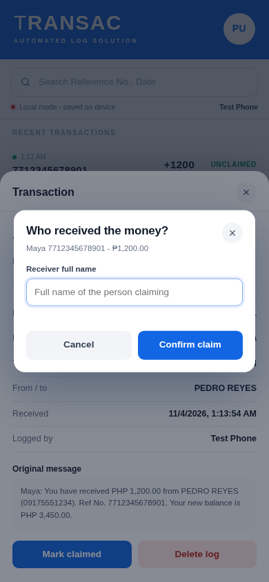

# TRANSAC - Automated Log Solution

**TRANSAC** replaces manual logging of GCash and Maya transactions. It monitors incoming SMS and
scans existing messages on the Android phone, parses every transaction notification, and keeps
a searchable ledger entirely on the device. The control center is built into the APK, so the app
works without a server, data connection, or Wi-Fi.

**[Download the Android APK](../../releases/latest/download/transac.apk)**

<p align="center">
  
  
</p>

## What it does

- **Monitors incoming SMS automatically** with an Android `BroadcastReceiver` and the `RECEIVE_SMS` permission.
- **Scans existing SMS** on first sign-in, on every app open, after the permission is granted, and every few minutes while the app is open. Old or missed transactions are captured too.
- **Parses GCash and Maya messages** into provider, reference number, amount, direction, sender, and status.
- **Keeps everything on the phone** in a local SQLite ledger. No server, internet, or Wi-Fi is required.
- **Includes the control center in the APK**: totals, search, filters, receiver names, and CSV export to Downloads.
- **Requires the receiver's full name when marking a transaction as claimed**, so every claim records who received the money.
- **Deduplicates by reference number**, so the same SMS is never logged twice.
- **Signs up and signs in locally** with an email/password account that stays on the device.
- **Optional central sync**: if you later run the included Node.js server, phones can share one ledger.

## Install on the phone

1. Download `transac.apk` on the Android phone.
2. Open it and allow **Install unknown apps** for the browser or file manager when prompted.
3. Open **TRANSAC** and allow the **SMS** and **storage** permissions when Android asks. Android 10 and newer manage storage automatically, so only the SMS prompt may appear.
4. On first launch, choose **Sign up**, enter a name, email, and password, and tap **Create account**. This creates a local account on the phone.
5. The app scans existing GCash/Maya messages and shows them in the ledger. New messages appear automatically.
6. Tap the avatar, then **Open control center**, to see the built-in dashboard.

No server is required. The app makes no network calls unless you explicitly add a central
server URL in the settings. The APK targets Android 7.0+ (API 24) and targets API 34. It is
signed with a demo key included in this repository; build your own release key before
publishing anywhere.

## Automatic SMS monitoring

TRANSAC treats a message as a transaction when the sender or body mentions GCash, G-Cash,
Mynt, Maya, or PayMaya and the message contains a peso amount.

- **Incoming messages:** the `SmsReceiver` runs whenever an SMS arrives, even when the app is closed.
- **Existing messages:** the app reads the SMS inbox after sign-in and then incrementally, using the newest scanned timestamp so it does not re-read the whole inbox.
- **Manual refresh:** **Avatar -> Import recent SMS** forces a full scan of the latest 500 messages.
- **Duplicates:** parsed transactions are unique by provider and reference number.

To test, send this to the phone from another number:

```
You have received PHP 500.00 from JUAN DELA CRUZ (09171234567).
Ref No. 6028871884223. Your new balance is PHP 1,500.00.
```

The transaction appears in the ledger and in the on-phone control center within a few seconds.

## Claiming a transaction

1. Open a received transaction.
2. Tap **Mark claimed**.
3. Enter the receiving person's full name.
4. Tap **Confirm claim**.

<p align="center">
  
</p>

The receiver name card is a centered pop-up over the transaction. The transaction becomes
`CLAIMED`, and the receiver's full name and claim time are stored with it. The control center
shows the receiver in its own column. If the phone is later connected to the optional server,
claim changes are pushed on the next sync.

The control center's **Export CSV** writes `transac-logs-YYYY-MM-DD.csv` to the phone's
Downloads folder. Android 10 and newer use scoped storage, so no storage permission is needed;
older versions ask for storage access once.

## Optional central server

The server is not needed for the phone app. It is useful when several phones must share one
ledger. The same APK can connect to it from the sign-in screen with **Use a central server**.

```bash
# from the repository root
npm start
```

No dependencies are required: the server uses only Node.js built-ins and a JSON store.

| URL | What it is |
| --- | --- |
| `http://localhost:3000/` | Mobile web app / installable PWA |
| `http://localhost:3000/dashboard` | Web control center |
| `http://<LAN-IP>:3000/` | Same app from a phone on the same network |

Demo account on the server:

```
Email:    demo@transac.app
Password: transac123
```

If several phones sign in to the same account, every transaction appears in one web dashboard
and each phone is listed under Connected devices. To use the phone app without a server, leave
the server field blank and use the local account.

### Phone cannot reach the server?

- Keep `npm start` running while testing.
- The phone and computer must be on the same Wi-Fi network.
- Use the computer's LAN address, never `localhost` or `127.0.0.1`.
- Allow TCP port `3000` through the computer firewall.
- If this project runs inside a virtual machine, switch the VM to bridged networking or
  forward port `3000` from the host. A NAT-only VM address such as `192.168.80.x` is usually
  not reachable from a phone.

## How it fits together

```
Android phone (works offline)                 Optional central server (Node.js)
┌──────────────────────────────────┐          ┌───────────────────────────┐
│ TRANSAC APK                      │          │ /api/auth/*   accounts    │
│  ├ SMS BroadcastReceiver         │  LAN or  │ /api/ingest   SMS/ledger  │
│  ├ Inbox scanner (old + missed)  │  HTTPS   │ /api/transactions         │
│  ├ SQLite ledger + local account │ ───────► │ /api/transactions/claim   │
│  ├ Built-in control center (UI)  │          │ /api/stats, /api/devices  │
│  └ claim receiver name           │ ◄─────── │ JSON store (data/db.json) │
└──────────────────────────────────┘          └───────────────────────────┘
```

The APK is the full application:

- **Mobile screen:** incoming and existing SMS become transactions in the on-device ledger.
- **Control center:** bundled in the APK. It reads the same SQLite ledger through the native
  `TransacNative` bridge, so totals, filters, claims, receiver names, and CSV export work
  without a server.
- **Optional server:** when a server URL is configured, the same ledger syncs to the web
  control center so several phones can share one account.

## Project structure

```
.
├── server.js                  # zero-dependency HTTP server + API
├── lib/
│   ├── parser.js              # GCash/Maya SMS parser (shared rules)
│   └── store.js               # JSON store, users, sessions, ledgers
├── public/                    # mobile app + control center + PWA
│   ├── index.html
│   ├── app.js
│   ├── styles.css
│   ├── dashboard.html
│   ├── dashboard.js
│   ├── dashboard.css
│   ├── manifest.webmanifest
│   └── sw.js
├── android-app/               # native Android wrapper (no Gradle)
│   ├── build.sh               # builds dist/transac.apk with aapt2 + d8
│   ├── AndroidManifest.xml
│   ├── java/com/transac/app/
│   │   ├── MainActivity.java  # WebView host
│   │   ├── Bridge.java        # TransacNative JavaScript bridge
│   │   ├── SmsReceiver.java   # incoming SMS
│   │   ├── SmsParser.java     # native parser (mirrors lib/parser.js)
│   │   ├── SyncClient.java    # auth + upload queue
│   │   ├── Db.java            # SQLite ledger
│   │   └── Time.java
│   └── res/
├── test/                      # parser and ledger unit tests
├── dist/transac.apk           # signed installable build
└── docs/screenshots/
```

## API

All ledger routes require `Authorization: Bearer <token>`.

| Method | Route | Purpose |
| --- | --- | --- |
| `POST` | `/api/auth/register` | Create an account, returns a token |
| `POST` | `/api/auth/login` | Sign in, returns a token |
| `POST` | `/api/auth/logout` | Revoke the current token |
| `GET` | `/api/auth/me` | Current user |
| `POST` | `/api/devices/register` | Register/refresh a phone |
| `POST` | `/api/ingest` | Parse and store one or many SMS messages |
| `GET` | `/api/transactions` | Paginated ledger with search/filters |
| `POST` | `/api/transactions` | Add a manual transaction |
| `PATCH` | `/api/transactions/:id` | Set `UNCLAIMED`, `CLAIMED`, or `SENT`; requires `claimedBy` for `CLAIMED` |
| `POST` | `/api/transactions/claim` | Claim by provider and reference (used by the phone sync) |
| `DELETE` | `/api/transactions/:id` | Delete a log |
| `GET` | `/api/stats` | Dashboard totals |
| `GET` | `/api/devices` | Connected devices |
| `POST` | `/api/parse` | Parse a message without storing it |

Example ingest request:

```json
{
  "device": { "id": "dev_abc123", "name": "Juan's phone", "platform": "android" },
  "messages": [
    {
      "sender": "GCash",
      "body": "You have received PHP 500.00 from JUAN DELA CRUZ. Ref No. 6028871884223.",
      "receivedAt": "2026-11-03T10:00:00.000Z"
    }
  ]
}
```

## Rebuild the APK

Requirements: JDK 11+ and Android SDK platform 34 + build-tools 34.0.0.

```bash
export ANDROID_HOME=/path/to/android-sdk
./android-app/build.sh
```

The script copies the web UI into `android-app/assets/www`, compiles resources with `aapt2`,
compiles the Java sources, dexes with `d8`, zipaligns, signs with
`android-app/transac.keystore` (password `transac123`), and writes `dist/transac.apk`.
It does not use Gradle, so the build stays fast and light.

Run the server tests with:

```bash
npm test
```

## Security notes and limitations

- The APK works with no network. It only talks to a server when you explicitly configure a
  server URL.
- The local account password is hashed with PBKDF2 and stored only on the phone. The optional
  server uses `scrypt` hashes and 256-bit bearer tokens that expire after 30 days.
- If a server is used, traffic is **HTTP on your LAN** by default. Use HTTPS and a real
  certificate before exposing it to the internet.
- The included signing keystore is a **demo key**. Generate your own for a public release.
- `READ_SMS` / `RECEIVE_SMS` are restricted permissions on Google Play. Sideloading the APK
  for a capstone demo is fine; publishing to Play requires an approved SMS use case.
- The JSON store is single-process and intended for a small deployment. Swap in PostgreSQL for
  production use.

## License

MIT. See [LICENSE](LICENSE).
