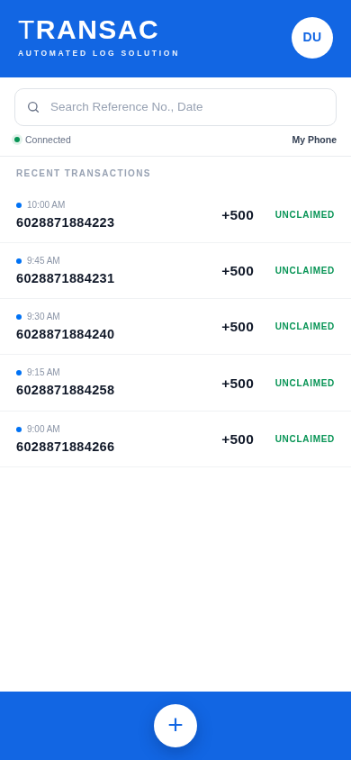
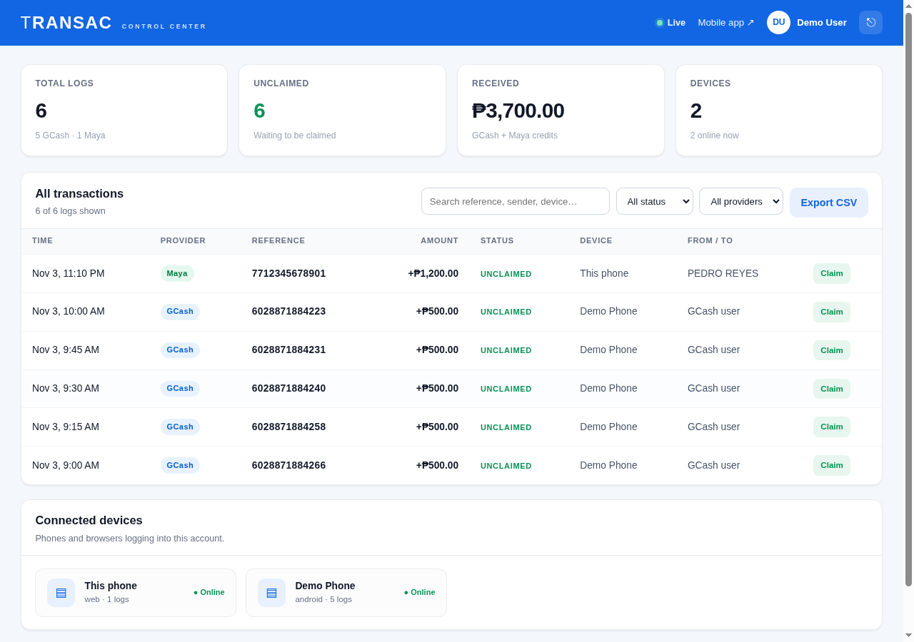

# TRANSAC - Automated Log Solution

**TRANSAC** reads GCash and Maya transaction messages on an Android phone and logs every
transaction into one centralized control center. It is built from the capstone prototype:
blue TRANSAC header, reference search, a single ledger list with `UNCLAIMED` statuses, and
the round **+** action.

<p align="center">
  
  
</p>

## What it does

- **Reads SMS automatically** on Android using a `BroadcastReceiver` and the `RECEIVE_SMS` permission.
- **Parses GCash and Maya messages** into provider, reference number, amount, direction, sender, and status.
- **Logs locally first** in SQLite so nothing is lost when the phone is offline.
- **Syncs to one central platform** where every phone's transactions appear in a single ledger.
- **Deduplicates by reference number**, so the same SMS is never logged twice.
- **Signs up and signs in** with an email/password account; each account only sees its own logs.
- **Works as a PWA too**: the same UI installs from the browser with "Add to Home Screen".

## Download and install the Android app

The signed APK is in [`dist/transac.apk`](dist/transac.apk) and attached to the
[latest release](../../releases/latest).

1. Download `transac.apk` on the Android phone.
2. Open it and allow **Install unknown apps** for the browser/file manager when prompted.
3. Open **TRANSAC**, allow the **SMS** permission, and sign in or create an account.
4. Enter the server address of the computer running this project, for example
   `http://192.168.1.10:3000` (phone and computer must be on the same Wi-Fi).

The app targets Android 7.0+ (API 24) and targets API 34. It is signed with a demo key
included in this repository; build your own release key before publishing anywhere.

## Run the centralized platform

```bash
# from the repository root
npm start
```

No dependencies are required: the server uses only Node.js built-ins and a JSON store.

| URL | What it is |
| --- | --- |
| `http://localhost:3000/` | Mobile app / installable PWA |
| `http://localhost:3000/dashboard` | Central control center |
| `http://<LAN-IP>:3000/` | Same app from a phone on the same network |

Open the app on the phone with the LAN URL, or install the APK and enter the LAN URL in the
sign-in screen. The terminal prints every available LAN address on startup.

### Demo account

```
Email:    demo@transac.app
Password: transac123
```

The demo account starts with five sample GCash logs that match the prototype. New accounts
start with an empty ledger; use the **+ → Demo** tab to log sample GCash/Maya SMS messages.

## Testing the SMS reader

1. Sign in on the phone and allow the SMS permission.
2. Send a text message to the phone containing a GCash/Maya style notification, for example:

   ```
   You have received PHP 500.00 from JUAN DELA CRUZ (09171234567).
   Ref No. 6028871884223. Your new balance is PHP 1,500.00.
   ```

3. The transaction appears in the phone list and on the control center within a few seconds.
4. Existing messages can be imported with **Avatar → Import recent SMS** (up to the last 500 messages).

Any SMS whose sender or body mentions GCash, G-Cash, Mynt, Maya, or PayMaya and contains a
peso amount is treated as a transaction. Messages are parsed on the device; the server receives
the original SMS body so it can re-parse with the same rules.

## How it fits together

```
Android phone                         Central server (Node.js)
┌──────────────────────────┐          ┌───────────────────────────┐
│ TRANSAC APK (WebView UI) │  HTTPS   │ /api/auth/*   accounts    │
│  ├ SQLite local ledger   │ ───────► │ /api/ingest   SMS/ledger  │
│  ├ SMS BroadcastReceiver │          │ /api/transactions         │
│  └ offline sync queue    │ ◄─────── │ /api/stats, /api/devices  │
└──────────────────────────┘          │ JSON store (data/db.json) │
                                      └─────────────┬─────────────┘
                                                    │
                                      ┌─────────────▼─────────────┐
                                      │ /dashboard control center  │
                                      └───────────────────────────┘
```

The same HTML/CSS/JS UI is used in two ways:

- **Browser/PWA:** served by `server.js`, talks to the API with `fetch` and a bearer token.
- **Android APK:** bundled in `assets/www`, talks to a native `TransacNative` JavaScript
  bridge. The bridge owns SQLite, SMS parsing, and syncing, so the UI works offline.

## Project structure

```
.
├── server.js                  # zero-dependency HTTP server + API
├── lib/
│   ├── parser.js              # GCash/Maya SMS parser (shared rules)
│   └── store.js               # JSON store, users, sessions, ledgers
├── public/                    # mobile app + control center + PWA
│   ├── index.html
│   ├── app.js
│   ├── styles.css
│   ├── dashboard.html
│   ├── dashboard.js
│   ├── dashboard.css
│   ├── manifest.webmanifest
│   └── sw.js
├── android-app/               # native Android wrapper (no Gradle)
│   ├── build.sh               # builds dist/transac.apk with aapt2 + d8
│   ├── AndroidManifest.xml
│   ├── java/com/transac/app/
│   │   ├── MainActivity.java  # WebView host
│   │   ├── Bridge.java        # TransacNative JavaScript bridge
│   │   ├── SmsReceiver.java   # incoming SMS
│   │   ├── SmsParser.java     # native parser (mirrors lib/parser.js)
│   │   ├── SyncClient.java    # auth + upload queue
│   │   ├── Db.java            # SQLite ledger
│   │   └── Time.java
│   └── res/
├── test/parser.test.js        # parser unit tests
├── dist/transac.apk           # signed installable build
└── docs/screenshots/
```

## API

All ledger routes require `Authorization: Bearer <token>`.

| Method | Route | Purpose |
| --- | --- | --- |
| `POST` | `/api/auth/register` | Create an account, returns a token |
| `POST` | `/api/auth/login` | Sign in, returns a token |
| `POST` | `/api/auth/logout` | Revoke the current token |
| `GET` | `/api/auth/me` | Current user |
| `POST` | `/api/devices/register` | Register/refresh a phone |
| `POST` | `/api/ingest` | Parse and store one or many SMS messages |
| `GET` | `/api/transactions` | Paginated ledger with search/filters |
| `POST` | `/api/transactions` | Add a manual transaction |
| `PATCH` | `/api/transactions/:id` | Set `UNCLAIMED`, `CLAIMED`, or `SENT` |
| `DELETE` | `/api/transactions/:id` | Delete a log |
| `GET` | `/api/stats` | Dashboard totals |
| `GET` | `/api/devices` | Connected devices |
| `POST` | `/api/parse` | Parse a message without storing it |

Example ingest request:

```json
{
  "device": { "id": "dev_abc123", "name": "Juan's phone", "platform": "android" },
  "messages": [
    {
      "sender": "GCash",
      "body": "You have received PHP 500.00 from JUAN DELA CRUZ. Ref No. 6028871884223.",
      "receivedAt": "2026-11-03T10:00:00.000Z"
    }
  ]
}
```

## Rebuild the APK

Requirements: JDK 11+ and Android SDK platform 34 + build-tools 34.0.0.

```bash
export ANDROID_HOME=/path/to/android-sdk
./android-app/build.sh
```

The script copies the web UI into `android-app/assets/www`, compiles resources with `aapt2`,
compiles the Java sources, dexes with `d8`, zipaligns, signs with
`android-app/transac.keystore` (password `transac123`), and writes `dist/transac.apk`.
It does not use Gradle, so the build stays fast and light.

Run the server tests with:

```bash
npm test
```

## Security notes and limitations

- This is a capstone/demo deployment. The APK talks to the server over **HTTP on your LAN**.
  Use HTTPS and a real certificate before exposing it to the internet.
- The included signing keystore is a **demo key**. Generate your own for a public release.
- `READ_SMS` / `RECEIVE_SMS` are restricted permissions on Google Play. Sideloading the APK
  for a capstone demo is fine; publishing to Play requires an approved SMS use case.
- Claiming/deleting a transaction in the app is local-only; the control center can claim logs
  for the central ledger. Full two-way status sync is a future improvement.
- Passwords are hashed with `scrypt` and sessions are random 256-bit bearer tokens that expire
  after 30 days.
- The JSON store is single-process and intended for a small deployment. Swap in PostgreSQL for
  production use.

## License

MIT. See [LICENSE](LICENSE).
